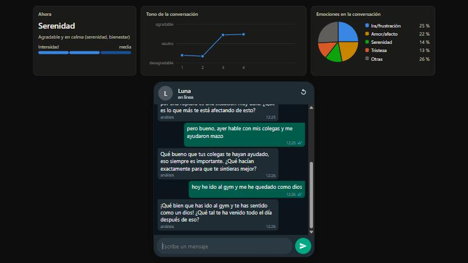

# Emotion Analysis System

Sistema en Python que **simula cómo un psicólogo lee las emociones** de una persona a partir de
cómo se expresa por escrito. No solo detecta *qué* emociones nombra: también se fija en **cómo habla**
(estilo del lenguaje, patrones de pensamiento, señales de riesgo), responde con **empatía** y propone
**preguntas** para seguir explorando, como en una consulta.

Es un **sistema híbrido**:
- **Modelos de lenguaje entrenados** ([pysentimiento](https://github.com/pysentimiento/pysentimiento)
  y un clasificador *zero-shot* de [Hugging Face](https://huggingface.co/MoritzLaurer/mDeBERTa-v3-base-mnli-xnli))
  para **entender cualquier forma de expresarse en español**, aunque no esté en ninguna lista.
- **Reglas** basadas en investigación psicológica para lo que tiene que ser **explicable y
  predecible**: distorsiones cognitivas, estilo del lenguaje y alerta de riesgo.
- [TextBlob](https://textblob.readthedocs.io/) para dividir el texto en frases y palabras.
- Un **LLM local** ([Ollama](https://ollama.com) con `gemma3:4b`) que **redacta las respuestas**
  como una persona, con tu mismo estilo.

Y se usa desde una **interfaz tipo WhatsApp** con gráficos que van midiendo las emociones de la
conversación.

> ⚠ Proyecto **educativo**. No diagnostica y no sustituye a un profesional de la salud mental.

## La interfaz: un chat con gráficos de emociones

```bash
python servidor.py          # se abre http://127.0.0.1:5000 en el navegador
```



- **Al abrirlo eliges el nombre del chat**: es el nombre de la persona con la que hablas (se
  presenta así y el LLM responde con ese nombre). Pulsando sobre el nombre se cambia.
- **Abajo, el chat**: como hablar con un amigo por WhatsApp (burbujas, *"escribiendo…"*, ✓✓).
  Debajo de cada respuesta, **análisis** muestra qué ha detectado el sistema y quién ha
  redactado la respuesta. El sistema no usa emojis (los tuyos se respetan).
- **Arriba, fuera del "móvil"**, tres gráficos que se actualizan con cada mensaje:

| Gráfico | Qué muestra | Cómo se comporta |
|---|---|---|
| **Ahora** | La emoción del último mensaje, el estado (valencia × activación) y un medidor de intensidad. Si hay riesgo, una alerta con el 024 | Es **un solo dato**: una tarjeta se lee mejor que un gráfico |
| **Tono de la conversación** | La valencia de cada mensaje, de *desagradable* (−1) a *agradable* (+1). Al pasar el ratón: mensaje, emoción y texto | **Avanza**: cada mensaje añade un punto y la línea se traza hasta él; los anteriores no se mueven ni se reescalan. Cuando no caben, la serie se desliza a la izquierda |
| **Emociones en la conversación** | Gráfico de **tarta** con las emociones acumuladas en la charla (la principal y las secundarias de cada mensaje), con leyenda de nombre y porcentaje | Las porciones **cambian de tamaño poco a poco**. Cada emoción **conserva su color** toda la conversación. Hasta 5 emociones + "Otras" |

Detalles de diseño:
- **El color sigue a la emoción, no a su posición**: si la ira es azul, sigue siendo azul aunque
  pase de ser la primera a la tercera. Por eso hay como máximo 8 colores (una paleta validada para
  daltonismo) y lo que no cabe va a "Otras", en gris.
- **La identidad nunca va solo por color**: la leyenda siempre dice nombre y porcentaje.
- **Modo oscuro** automático y todo dibujado en SVG/HTML sin librerías externas: funciona
  **sin internet**. Por dentro, [`servidor.py`](servidor.py) (Flask) recibe cada mensaje,
lo analiza, pide la respuesta y devuelve los datos que pinta [`web/app.js`](web/app.js).

## Respuestas redactadas por un LLM local (Ollama)

Las reglas y los clasificadores saben **qué** emoción hay, pero no entienden lo que quieres decir
(el humor, de qué hablas de verdad), y las plantillas suenan a máquina. Por eso las respuestas
las redacta un **LLM (modelo de lenguaje grande)** que corre en tu ordenador:

```
tu mensaje ──► ANÁLISIS (reglas + modelos): emoción, distorsiones, estilo, riesgo
                   │
                   ├─ riesgo alto ──────────────► mensaje de seguridad fijo (024)
                   │
                   └─► LLM: instrucciones + conversación + notas del análisis ──► respuesta
                              │
                              └─ ¿cumple las normas? no ─► se corrige 1 vez ─► si no, plantillas
```

- **[`llm.py`](llm.py)** le pasa al modelo tres cosas: unas **instrucciones fijas** (*system
  prompt*: habla con su estilo, tacos sí, insultos no, sé objetivo, sin falsos ánimos, una sola
  pregunta), **la conversación entera** y unas **notas del análisis** de tu último mensaje
  (emoción, distorsiones, si usas *bro* o *xoxo*, si hablas de usted…).
- **Ejemplos dentro del prompt** (*few-shot*): a los modelos pequeños les ayuda mucho más
  **ver** cómo responder que leer normas. Efecto secundario: copiaba el *"bro"* de los ejemplos
  aunque no lo hubieras dicho, así que las notas le prohíben usar vocativos que no uses tú.
- **No supone el género**: al principio respondía *"te sientes muy frustrada"* sin que la persona
  lo hubiera dicho. Ahora usa formas neutras (*"estás con mucha frustración"*) salvo que la
  persona lo deje claro (*"estoy rayada"*).
- **Control de calidad**: si la respuesta insulta, dramatiza (*"qué horror"*), se salta el
  usted o tiene palabras mal escritas, se le pide que la corrija; si sigue mal, se usa la de
  plantillas. Los emojis tristes se quitan siempre.
- **La seguridad nunca depende del LLM**: si las reglas detectan riesgo, el mensaje con el 024
  sale siempre.
- **Privado**: Ollama corre en tu ordenador; los mensajes no salen de él.

Para instalarlo:
```bash
winget install Ollama.Ollama        # o desde https://ollama.com
ollama pull gemma3:4b               # ~3,3 GB
```
Sin Ollama, el sistema funciona igual, pero responde con plantillas. Se puede usar otro modelo
con la variable de entorno `OLLAMA_MODELO` (por ejemplo, `gemma3:12b`: entiende mejor, pero va
más lento).

## Ejemplo en la terminal

```
$ python main.py --texto "Estoy bien, pero ya no puedo más. Siempre me pasa lo mismo, soy un fracasado."

1. EMOCIONES DETECTADAS
   Principal: 😢 Tristeza   ·   Secundarias: 😳 Vergüenza
2. ESTADO AFECTIVO (modelo circumplejo de Russell)
   desagradable ─────●─────────────── agradable
        apagado ─────────●─────────── activado
   → Desagradable y con poca energía (desánimo, abatimiento)
3. CÓMO SE EXPRESA
   • Desesperanza: «ya no puedo más»
   • Posible minimización: «Estoy bien»
4. PATRONES DE PENSAMIENTO
   • Sobregeneralización: «Siempre me pasa»
     ↳ Para reformular: ¿De verdad es *siempre*, *nunca* o *nadie*? ¿Recuerdas alguna excepción?
   • Etiquetarse: «soy un fracasado»
5. RESPUESTA (objetiva y adaptada a su forma de expresarse)
   Estilo detectado: neutro · tú · mensaje media
   💬 Entiendo. Por lo que cuentas, estás pasando un momento triste. Dices que estás bien,
      aunque no parece que del todo. ¿Desde cuándo te sientes así?
```

## Instalación y uso

```bash
# PyTorch en su versión solo CPU (más ligera, no necesita tarjeta gráfica)
pip install torch --index-url https://download.pytorch.org/whl/cpu
pip install -r requirements.txt
python -m textblob.download_corpora lite

ollama pull gemma3:4b                            # opcional: LLM local para redactar respuestas

python servidor.py                               # interfaz tipo WhatsApp con gráficos
python main.py                                   # conversación en la terminal (/informe, /resumen, /salir)
python main.py --sin-llm                         # respuestas con plantillas
python main.py --solo-reglas                     # sin modelos ni LLM (rápido, sin descargas)
python main.py --texto "Me siento sola..."       # un texto
python main.py --sesion ejemplos/sesion_ejemplo.txt   # evolución de una sesión
python main.py --demo                            # ejemplos
python main.py --demo --traza                    # muestra cómo se calcula cada punto
python -m unittest -v                            # tests
```

## Qué habilidades del psicólogo simula

| Habilidad | Base teórica | Implementación |
|---|---|---|
| Distinguir matices emocionales | Granularidad emocional (L. Feldman Barrett) | 13 emociones: alegría, serenidad, amor, esperanza, sorpresa, tristeza, soledad, ira, miedo, ansiedad, culpa, vergüenza y asco |
| Notar si alguien está agitado o apagado | Modelo circumplejo (Russell, 1980) | Cada emoción tiene coordenadas de **valencia × activación** y se calcula el estado global |
| Fijarse en *cómo* se habla | Pennebaker (LIWC); Al-Mosaiwi y Johnstone (2018) | Autofoco ("yo/me/mi"), absolutismo ("siempre/nunca"), rumiación, preocupación, síntomas físicos, vaguedad |
| Leer entre líneas | Práctica clínica | Lo que va tras el **"pero"** pesa más; detección de **minimización** ("estoy bien, pero…") y **ambivalencia** |
| Detectar pensamientos que hacen daño | Terapia cognitiva (Beck, Burns) | 9 **distorsiones cognitivas**, cada una con una pregunta socrática para reformularla |
| Entender que los pensamientos generan emociones | Modelo cognitivo (A. Beck) | "¿Y si suspendo?" suma **ansiedad** aunque no aparezca ninguna palabra emocional |
| Hablar "en su idioma" | Sincronía de estilo lingüístico (Ireland y Pennebaker, 2010) | Detecta registro (formal → coloquial), tú/usted, emojis, interjecciones y autodescripciones, y **responde con el mismo estilo** |
| Responder con objetividad | Terapia cognitiva: hechos frente a interpretaciones | La respuesta se basa en lo dicho y separa hechos de suposiciones, sin falsos ánimos |
| Hacer buenas preguntas | Diálogo socrático | Preguntas adaptadas a la emoción, las señales y las distorsiones |
| Seguir la evolución | Seguimiento de la sesión | **Modo sesión**: trayectoria de la valencia, tendencia y patrones repetidos |
| Detectar riesgo y derivar | Cribado de riesgo | **Alerta** ante ideación suicida o autolesión (también en formas indirectas) con recursos: **024** y **112** |

## La respuesta: misma cercanía, sin copiar la negatividad

El sistema adapta **la forma** de responder a cómo escribe la persona, pero **no copia su malestar**:

| Mensaje | Respuesta |
|---|---|
| *tia estoy mazo rayada con lo del examen, en plan q no me entra nada y seguro q suspendo 😭* | Uf, vale, tia. Por lo que dices, estás rayada con lo del examen. Eso todavía no ha pasado, así que no sabemos cómo va a salir. Oye, ¿qué es lo que más te preocupa ahora mismo? 🫂 |
| *joder estoy de puta pena, mi jefe es un gilipollas y todo me sale mal, soy un desastre* | Joder, vale. Por lo que dices, estás de puta pena con lo de tu jefe. Que algo no haya salido bien no te define como persona. Oye, ¿desde cuándo te sientes así? |
| *Buenas tardes. Le escribo porque últimamente me siento muy cansada y preocupada por mi trabajo.* | Gracias por contármelo. Por lo que me cuenta, está cansada y preocupada por su trabajo. ¿Desde cuándo se siente así? |
| *uf bro estoy hasta los huevos del curro* | Uf, vale, bro. Por lo que dices, estás hasta los huevos del curro. Oye, ¿qué es lo que más te ha molestado? |
| *tía me han dado el trabajo!! estoy de puta madre xoxo* | ¡Qué guay, tía! Por lo que dices, estás de puta madre con lo del trabajo. Oye, ¿qué significa esto para ti? xoxo |

**Qué refleja**: el registro, tú o usted, sus **tacos**, sus **vocativos** (*bro, tía, tío, cari,
crack…*), sus **despedidas** (*xoxo, besis, un abrazo…*), sus interjecciones ("uf", "joder", "jaja")
si encajan con el tono, sus emojis (solo los de apoyo, nunca 😭), sus **expresiones**
("rayada", "hasta los huevos", "más tranqui") con su misma preposición ("preocupada *por* su
trabajo"), y una longitud parecida a la de su mensaje.

**Qué NO copia** (eso no es su forma de hablar, es negatividad): insultos a sí misma o a otros
("soy un desastre", "es un gilipollas"), palabras absolutistas ("siempre", "nada", "nadie"),
intensificadores del malestar ("mazo", "muy") y emojis negativos.

Para un modo sin tacos: `ESPEJO_TACOS = False` en [`expresiones.py`](expresiones.py). Así,
*"hasta la polla"* se devuelve como *"hasta las narices"*: la misma cercanía, sin el taco.

**Objetividad**: se basa en lo que ha dicho ("Por lo que cuentas…"), separa hechos de
interpretaciones ("todavía no ha pasado, así que no sabemos cómo va a salir") y evita los falsos
ánimos como "seguro que todo irá bien".

Ante un **riesgo**, la seguridad va por delante del estilo: el mensaje es claro y directo y da el 024.

## Cómo entiende el español: sistema híbrido

### El problema de las listas
Un sistema solo de reglas **compara texto**: si *"la casa se me hace enorme y silenciosa"* no está en
su diccionario, no entiende nada. Y ninguna lista puede cubrir todo lo que se dice en español.

### La solución: modelos de lenguaje entrenados
Los modelos de [`modelos.py`](modelos.py) no buscan palabras: **han aprendido el significado** a partir
de millones de textos reales.
- Convierten cada frase en vectores de números (**embeddings**) donde las frases con significado
  parecido quedan cerca, aunque no compartan ninguna palabra.
- Son **transformers**: leen la frase entera con su contexto ("me mato a estudiar" ≠ "me quiero matar").

Se usan dos, de lo general a lo concreto, como haría un psicólogo:

| Modelo | Qué es | Para qué lo usamos |
|---|---|---|
| **[pysentimiento](https://github.com/pysentimiento/pysentimiento)** (RoBERTuito) | Un transformer entrenado con **tuits en español**, con jerga y tacos incluidos | La **familia** de la emoción (alegría, tristeza, ira, miedo, sorpresa, asco o sin emoción), la **ironía** y decidir si el texto es **neutral** |
| **Zero-shot** ([mDeBERTa-v3 XNLI](https://huggingface.co/MoritzLaurer/mDeBERTa-v3-base-mnli-xnli)) | Un modelo multilingüe entrenado en **NLI** (*Natural Language Inference*): decidir si una hipótesis **se deduce** de un texto | El **matiz**: le damos la hipótesis *"En este texto, la persona siente culpa por algo que hizo."* y nos dice cómo de probable es. Así distingue **culpa, vergüenza, soledad, ansiedad…** sin haber sido entrenado para ellas |

### Cómo se combinan
```
texto ──► REGLAS (léxico + expresiones + marcadores) ──────────────┐
      │                                                              ├──► FUSIÓN ──► emoción final
      └─► pysentimiento: familia + ironía + ¿neutral?                │
              └─► zero-shot: matiz dentro de la familia ────────────┘
                  (+ culpa, vergüenza, soledad y ansiedad siempre)
```
1. **Si las reglas no encuentran nada** (una expresión que no está en las listas), **decide el
   modelo**, salvo que pysentimiento esté ≥ 90 % seguro de que el texto es neutral.
2. **Si los dos opinan**, se hace la media **50 % reglas y 50 % modelos**. El peso del modelo baja si
   cree que el texto es neutral. Cuando las reglas encuentran una expresión explícita
   (*"no puedo con mi alma"*), hay que fiarse de ellas.
3. **Ironía**: si el modelo está muy seguro (≥ 90 %) **y** hay palabras positivas literales, esa
   "alegría" pasa a **frustración**: *"Genial, otra vez lunes y lloviendo"* → ira.
4. **Las reglas se quedan** para lo que tiene que ser **explicable y predecible**: distorsiones
   cognitivas, estilo, respuesta y, sobre todo, la **alerta de riesgo**, que nunca depende de lo que
   "opine" un modelo.

### Resultados: frases que no están en ninguna lista

| Frase | Solo reglas | Híbrido |
|---|---|---|
| Desde que se fue mi abuela la casa se me hace enorme y silenciosa | neutral ❌ | **soledad** ✅ |
| Me han vuelto a cobrar dos veces la factura y nadie del servicio técnico me coge el teléfono | neutral ❌ | **ira** ✅ |
| Por fin he aprobado el carnet de conducir a la primera | neutral ❌ | **alegría** ✅ |
| Mañana me operan y no paro de imaginar que algo sale mal | neutral ❌ | **ansiedad** ✅ |
| Genial, otra vez lunes y lloviendo, qué maravilla de vida | alegría ❌ | **ira** (ironía) ✅ |
| a veces pienso que quiero morirme | neutral (riesgo ✅) | **tristeza** (riesgo ✅) |
| El autobús sale a las ocho y cuarto | neutral ✅ | **neutral** ✅ |

En el informe se ve qué opina cada fuente (salida real para la frase de la factura):
```
   Fuente: híbrido (reglas + modelos)
   · Modelo de emociones (pysentimiento): Ira/frustración 85%, sin emoción 6%, Asco 4%
   · Matices (zero-shot): Soledad 87%, Culpa 4%, Ira/frustración 3%
   · Ironía: 0%
```
Aquí se ve por qué conviene **combinar** modelos: el zero-shot solo habría dicho "soledad" (por el
*"nadie me coge el teléfono"*), pero pysentimiento está un 85 % seguro de que es ira, y la fusión
acierta.

### Lo que aprendimos al probarlo
Los modelos **no son mágicos**, y medirlos con frases reales cambió el diseño varias veces:
- **El zero-shot multi-etiqueta dice "sí" a todo** (~99 % para cada emoción). Hay que hacer que las
  etiquetas **compitan** entre sí (softmax).
- **El zero-shot no sabe decir "sin emoción"**: a *"La reunión es en la sala 3"* le da ~100 % de que
  "expresa emociones", y además **tiende a elegir "sorpresa"**. Por eso la neutralidad la decide
  pysentimiento, que sí la distingue (98-99 % en los textos neutros).
- **Las descripciones importan**: con solo *"amor"*, *"he aprobado el carnet"* salía amor. Con
  *"amor o cariño hacia alguien"* sale alegría.
- **El modelo de ironía da falsos positivos fuera de Twitter** (98 % de ironía en *"he aprobado el
  carnet"*), así que solo se tiene en cuenta si está muy seguro **y** hay palabras positivas
  literales.
- **Velocidad**: probar las 13 emociones una a una tardaba 8 s por mensaje. Probando solo las de las
  familias probables, todas en un único lote (*batch*), tarda unos 3 s.

## Cómo funciona por dentro (reglas)

1. **Segmentación (TextBlob)**: oraciones → palabras. Se normaliza (minúsculas, sin tildes).
2. **Puntuación emocional** ([`lexico.py`](lexico.py)): cada palabra o expresión tiene una emoción y
   un peso de 1 a 3. Sobre eso se aplican reglas:
   - **Negación** (3 palabras hacia atrás): *"no estoy feliz"* → tristeza, *"no tengo miedo"* → se anula.
   - **Intensificadores**: `muy` ×1.5, `extremadamente` ×2, `poco` ×0.5…
   - **MAYÚSCULAS** ×1.3, **exclamaciones** +20 % cada una y **emojis**.
   - **Contraste**: antes del "pero" ×0.7 y después ×1.3.
   - **Pensamientos → emociones**: preocupación y catastrofismo suman ansiedad, el etiquetado suma
     vergüenza, etc.
3. **Resultado emocional**: porcentajes, emoción principal y secundarias, e intensidad
   (puntos por palabra).
4. **Estado afectivo**: la media ponderada de las coordenadas da un punto en el plano
   valencia × activación y su cuadrante.
5. **Marcadores y distorsiones** ([`marcadores.py`](marcadores.py)): expresiones regulares y conteos
   que citan las palabras exactas de la persona como evidencia.
6. **Informe** ([`informe.py`](informe.py)): reflejo empático, preguntas, alerta de riesgo y resumen
   de la sesión.

Con `--traza` se ve cada paso del cálculo, por ejemplo:

```
· 'sin dormir' -> ansiedad +2.00
· pensamiento 'preocupacion' (y si) -> ansiedad +2
· pensamiento 'adivinacion' (Seguro que sale mal) -> ansiedad +2
```

## Limitaciones

- **Los modelos se equivocan** y no explican *por qué*. Por eso el informe enseña qué opina cada
  fuente, y el riesgo lo deciden siempre las reglas.
- **Recursos**: unos 2 GB de descarga la primera vez (PyTorch + 3 modelos) y unos 3 s por mensaje en
  CPU. Con `--solo-reglas` es instantáneo, pero entiende menos.
- **Privacidad**: todo se ejecuta en tu ordenador. Solo se usa internet para descargar los modelos la
  primera vez; los textos no se envían a ningún sitio.
- **El LLM es pequeño** (4B parámetros) para que vaya en un portátil: a veces suena raro o se
  salta alguna norma (el control de calidad recoge las más importantes). Tarda unos 10 s por
  respuesta en CPU.
- **Memoria de conversación**: un mensaje corto sin emoción clara **hereda la del anterior**
  (*"todo bro, no hay quesitos en clase"* sigue siendo enfado). Es una regla simple: si
  cambias de tema con un mensaje corto, puede arrastrar la emoción de antes.
- **Reflejar** una expresión con las palabras de la persona necesita reconocerla, así que para eso
  [`expresiones.py`](expresiones.py) sigue siendo útil.
- Está pensado para **español**. En inglés se usan solo las reglas y la polaridad de TextBlob.
- El riesgo se detecta por patrones. Se prefiere un falso positivo antes que dejar pasar un caso real.

## Estructura

```
servidor.py          interfaz gráfica: servidor Flask + API del chat
web/                 chat tipo WhatsApp y gráficos (HTML, CSS, JavaScript)
llm.py               respuestas redactadas por un LLM local (Ollama) con control de calidad
main.py              programa de terminal (consulta, texto, sesión, demo)
analizador.py        motor de análisis y fusión reglas + modelos -> objeto Analisis
modelos.py           modelos de lenguaje: pysentimiento (familia, ironía) y zero-shot (matices)
expresiones.py       expresiones idiomáticas del español, tacos, eufemismos
informe.py           informe tipo psicólogo y resumen de sesión
respuesta.py         respuesta objetiva adaptada al estilo de la persona
estilo.py            detección del estilo (registro, tú/usted, expresiones, temas)
lexico.py            emociones, pesos, modelo circumplejo, negaciones, intensificadores
marcadores.py        marcadores lingüísticos, distorsiones cognitivas y riesgo
utils.py             normalización, abreviaturas ("q" -> "que") y búsqueda de expresiones
test_analizador.py   51 tests de las reglas y la conversación (deterministas)
test_servidor.py     8 tests de la API del chat
test_modelos.py      7 tests del modo híbrido, con frases que no están en ninguna lista
test_llm.py          5 tests de las respuestas del LLM (propiedades: nunca insulta, usted, 024…)
ejemplos/            sesión de ejemplo
```

## Si necesitas ayuda

Si tú o alguien cercano está pasando por un mal momento o tiene pensamientos de hacerse daño:
**024** (Línea de atención a la conducta suicida, España, gratuita, 24 h) · **112** (emergencias) ·
fuera de España: [findahelpline.com](https://findahelpline.com).
